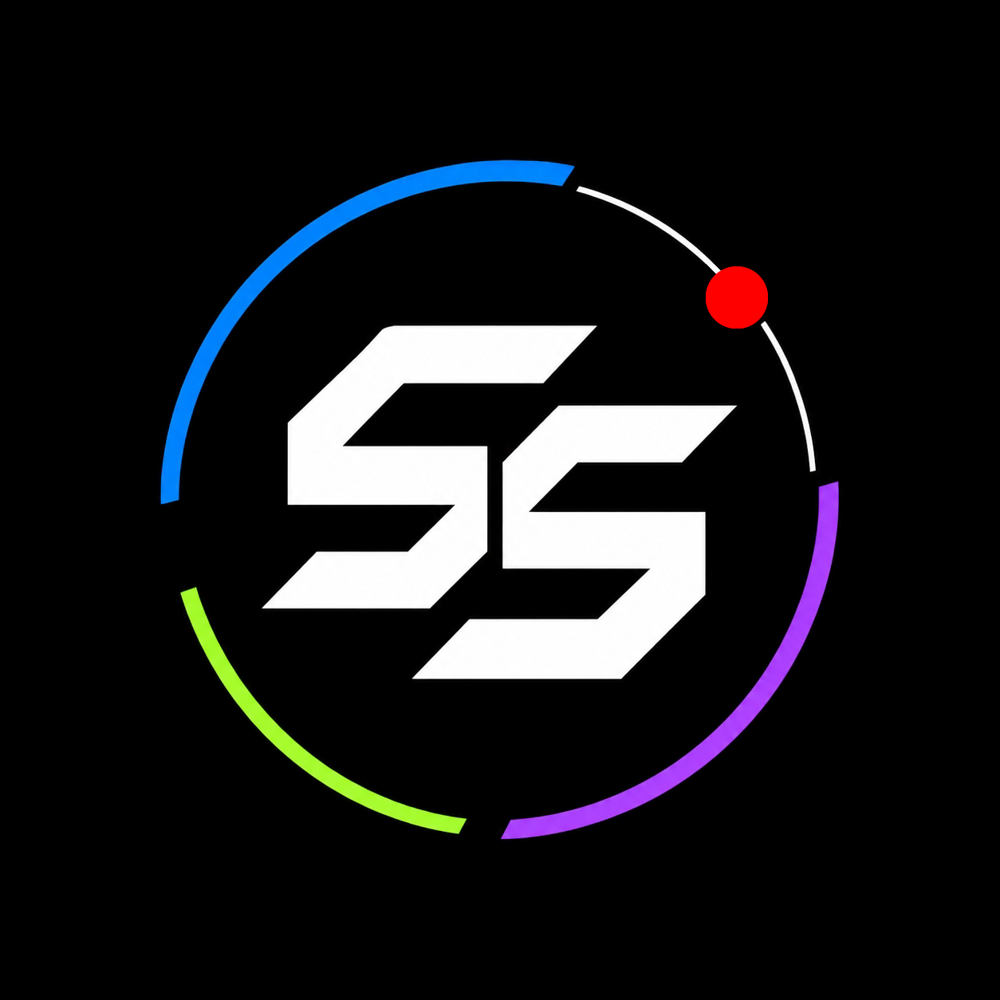
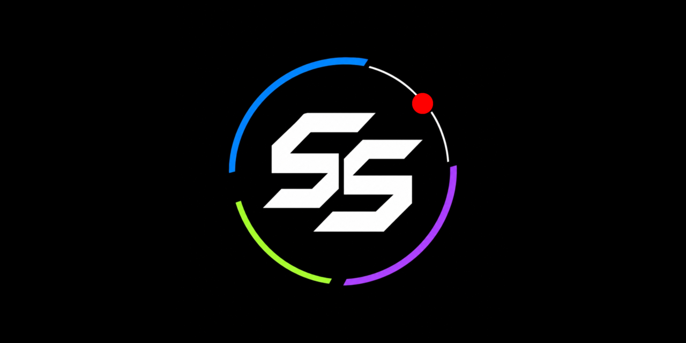

<div align="center">

  <br>

  

  <h1>SHIVANG SAGAR</h1>

  <h3>
    <span style="color:#00F0FF">D I G I T A L</span>
    &nbsp; N E X U S
  </h3>

  <p>
    <strong>◈ THE DIGITAL COMMAND CENTER ◈</strong>
  </p>

  <p>
    <em>One Identity. Multiple Dimensions. Infinite Possibilities.</em>
  </p>

  <br>

  <a href="https://shivangsagar.github.io/">
    
  </a>

  <a href="https://github.com/shivangsagar/shivangsagar.github.io">
    
  </a>

  <br><br>

  
  
  
  
  

  <br><br>

  
  
  

  <br><br>

  <p>
    A handcrafted, futuristic and interactive digital gateway
    connecting my professional identity, projects, applications
    and open-source presence.
  </p>

</div>

<br>

---

<div align="center">

### ◈ SYSTEM OVERVIEW ◈

|  |  |  |  |
|:---:|:---:|:---:|:---:|
| **LINKEDIN** | **GITHUB** | **PORTFOLIO** | **PRESENCIA** |
| Professional | Development | Projects | Application |

</div>

##  THE CONCEPT

**Digital Nexus** is my personal digital command center, bringing together different dimensions of my digital presence through a single, unified interface.

Designed around a pure-black canvas, vibrant chromatic accents, futuristic typography and a custom SS identity mark, the website moves beyond conventional link pages.

Every interaction is designed to feel intentional.

Every portal represents a different part of my digital identity.

The result is an immersive navigation experience built with lightweight web technologies and custom JavaScript interactions.

> **One destination. Everything connected.**

---

##  EXPLORE THE PORTALS

<div align="center">

<table>
<tr>
<td width="50%" align="center">

###  LINKEDIN


Professional identity, career journey, networking and connections.

<br>

<a href="https://www.linkedin.com/in/shivangsagar/">

</a>

</td>
<td width="50%" align="center">

###  GITHUB


Repositories, experiments, source code, development and contributions.

<br>

<a href="https://github.com/shivangsagar/">

</a>

</td>
</tr>

<tr>
<td width="50%" align="center">

###  PORTFOLIO


Engineering projects, technical skills, creative work and case studies.

<br>

<a href="https://shivangsagar.github.io/portfolio/">

</a>

</td>
<td width="50%" align="center">

###  PRESENCIA


An attendance management application and its associated web presence.

<br>

<a href="https://shivangsagar.github.io/Presencia/">

</a>

</td>
</tr>
</table>

</div>

---

##  THE EXPERIENCE

This is not just a collection of hyperlinks. It is an interactive environment with multiple layers of visual and functional details.

<table>
<tr>
<td width="50%">

### 

**QUANTUM CANVAS**

An interactive particle system with connected particle lines, pointer-responsive movement and expanding shockwaves.

</td>
<td width="50%">

### 

**3D HOLOGRAPHIC PORTALS**

Dynamic navigation cards featuring perspective tilt, magnetic hover behaviour, individual accent colours and glow effects.

</td>
</tr>
<tr>
<td width="50%">

### 

**TELEMETRY HUD**

A live UTC clock and real-time cursor coordinate display integrated into the interface.

</td>
<td width="50%">

### 

**CHROMATIC IDENTITY**

A custom SS monogram with interactive shockwave effects and animated glitch typography.

</td>
</tr>
<tr>
<td width="50%">

### 

**DYNAMIC CONTRAST MODES**

Three distinct visual modes:

- Dual Chroma
- Hyper Vibrant
- Pure Monochrome

</td>
<td width="50%">

### 

**CYBER SYNTH AUDIO**

Procedurally generated interface sound effects using the Web Audio API, with an independent sound toggle.

</td>
</tr>
<tr>
<td width="50%">

### 

**COMMAND MATRIX**

A searchable command palette that provides quick access to all available portals.

</td>
<td width="50%">

### 

**CUSTOM CURSOR**

A custom dual-ring cursor with interactive hover feedback.

</td>
</tr>
<tr>
<td width="50%">

### 

**KEYBOARD INTERACTION**

Launch portals, switch modes, activate sound and trigger visual effects without using a mouse.

</td>
<td width="50%">

### 

**SOCIAL INTEGRATION**

Custom Open Graph and Twitter Card metadata with a dedicated 1280 × 640 social preview.

</td>
</tr>
</table>

---

##  KEYBOARD COMMANDS

The Nexus includes a dedicated keyboard interaction system.

| KEY / SHORTCUT | COMMAND |
|:---:|:---|
| <kbd>1</kbd> | Launch LinkedIn |
| <kbd>2</kbd> | Launch GitHub |
| <kbd>3</kbd> | Launch Portfolio |
| <kbd>4</kbd> | Launch Presencia |
| <kbd>SPACE</kbd> | Trigger Gravity Pulse |
| <kbd>M</kbd> | Cycle Contrast Modes |
| <kbd>S</kbd> | Toggle Sound Effects |
| <kbd>/</kbd> | Open Command Palette |
| <kbd>CTRL</kbd> + <kbd>K</kbd> | Open Command Palette |
| <kbd>ESC</kbd> | Close Command Palette |

**Navigation tip:** Press `/` or `Ctrl + K` to access the searchable Command Matrix and quickly locate a portal.

---

##  VISUAL IDENTITY

The design follows a high-contrast chromatic system built around absolute black and vibrant accent colours.

### Colour palette

<div align="center">

| COLOUR | HEX CODE | ROLE |
|:---:|:---:|:---|
|  | `#000000` | Primary Background |
|  | `#00F0FF` | Electric Cyan |
|  | `#BD00FF` | Hyper Violet |
|  | `#CCFF00` | Acid Lime |
|  | `#FF0055` | Neon Crimson |
|  | `#FFFFFF` | Monochrome White |

</div>

### Typography

| FONT FAMILY | APPLICATION |
|:---|:---|
| **Syne** | Bold identity and prominent typography |
| **Space Grotesk** | Interface headings and content |
| **JetBrains Mono** | Technical labels, telemetry and system elements |

The visual language combines sharp geometric elements, neon accents, luminous effects, subtle motion and technical interface details.

---

##  TECHNOLOGY STACK

A lightweight implementation without a frontend framework or complex build pipeline.

<div align="center">

| TECHNOLOGY | PURPOSE |
|:---:|:---|
|  | Semantic Structure |
|  | Styling & Animations |
|  | Interaction & Logic |
|  | Particle Rendering |
|  | Synthesized Sound |
|  | Typography |
|  | Deployment |

</div>

---

##  PROJECT ARCHITECTURE

The repository follows a simple and maintainable static website structure.

```text
shivangsagar.github.io/
│
├── assets/
│   ├── favicon.png
│   └── social-preview.png
│
├── index.html
│
├── style.css
│
├── script.js
│
└── README.md
```

### File responsibilities

| FILE / DIRECTORY | RESPONSIBILITY |
|:---|:---|
| `index.html` | Main website structure, metadata, portal container and interface elements |
| `style.css` | Visual design, colour system, layout, responsiveness and animations |
| `script.js` | Portal configuration, interactions, particle engine, audio and command palette |
| `assets/favicon.png` | Custom SS browser favicon |
| `assets/social-preview.png` | Website social sharing preview image |
| `README.md` | Project documentation |

---

##  EXTENDING THE NEXUS

The navigation engine is designed to be extensible.

Adding new portals does not require manually recreating the entire HTML card structure.

Portal configurations are maintained in the `PORTAL_LINKS` array inside `script.js`.

### Adding another portal

1. Open `script.js`.
2. Locate the `PORTAL_LINKS` array.
3. Add a new portal object.
4. Specify its title, URL, description, display URL, keyboard shortcut, colour and SVG icon.
5. Save and deploy.

The rendering engine automatically generates the corresponding navigation card, keyboard shortcut and Command Palette entry.

### Portal configuration properties

| PROPERTY | DESCRIPTION |
|:---|:---|
| `index` | Portal identification label |
| `key` | Keyboard shortcut |
| `title` | Portal name |
| `desc` | Short description |
| `url` | Destination URL |
| `displayUrl` | URL displayed on the card |
| `color` | Accent colour in HEX |
| `rgb` | RGB equivalent of the accent |
| `icon` | SVG icon markup |

This configuration-driven approach keeps the navigation system easy to maintain and expand.

---

##  RUN LOCALLY

Want to explore or modify the project locally?

### 01 — Clone the repository

```bash
git clone https://github.com/shivangsagar/shivangsagar.github.io.git
```

### 02 — Enter the project directory

```bash
cd shivangsagar.github.io
```

### 03 — Start a local development server

```bash
python -m http.server 8000
```

### 04 — Open in your browser

```text
http://localhost:8000
```

No `npm install`, package manager or build command is required.

---

##  DEPLOYMENT

The website is hosted through **GitHub Pages**.

| CONFIGURATION | VALUE |
|:---|:---|
| Repository | `shivangsagar.github.io` |
| Branch | `main` |
| Deployment Source | Repository Root |
| Hosting Platform | GitHub Pages |
| Framework | None |

### Production links

<div align="center">

<a href="https://shivangsagar.github.io/">

</a>

<a href="https://github.com/shivangsagar/shivangsagar.github.io">

</a>

</div>

---

##  SOCIAL PREVIEW & BRAND ASSETS

The repository includes custom visual assets for consistent branding across browser tabs and social platforms.

### Social preview

<div align="center">



<br>


</div>

### Favicon

<div align="center">


<p><strong>SS — Custom Digital Identity</strong></p>

</div>

The website references the social preview through Open Graph and Twitter Card metadata, allowing supported platforms to display a large preview when the website URL is shared.

---

##  DESIGN PHILOSOPHY

Digital Nexus is built around three fundamental ideas:

<table>
<tr>
<td align="center" width="33%">

### PRECISION

Every element has a purpose. Minimal structure, deliberate spacing and functional interactions.

</td>
<td align="center" width="33%">

### IDENTITY

A distinctive visual language that combines monochrome foundations with vibrant chromatic accents.

</td>
<td align="center" width="33%">

### EXTENSIBILITY

A configuration-driven architecture designed to accommodate new destinations and projects.

</td>
</tr>
</table>

The goal is not simply to make a website look futuristic.

It is to create a recognizable digital identity that feels cohesive, functional and memorable.

---

<div align="center">

<br>


<h1>◈ END OF TRANSMISSION ◈</h1>

<h3>SHIVANG SAGAR</h3>

<p>
  <strong>ENGINEERED WITH PRECISION.</strong>
  <br>
  <strong>DESIGNED TO CONNECT.</strong>
</p>

<br>

<a href="https://shivangsagar.github.io/">

</a>

<br><br>

<a href="https://www.linkedin.com/in/shivangsagar/">LINKEDIN</a>
&nbsp; • &nbsp;
<a href="https://github.com/shivangsagar/">GITHUB</a>
&nbsp; • &nbsp;
<a href="https://shivangsagar.github.io/portfolio/">PORTFOLIO</a>
&nbsp; • &nbsp;
<a href="https://shivangsagar.github.io/Presencia/">PRESENCIA</a>

<br><br>


<br><br>

<sub>© 2026 Shivang Sagar. All rights reserved.</sub>

<sub>Designed & developed by Shivang Sagar.</sub>

</div>
